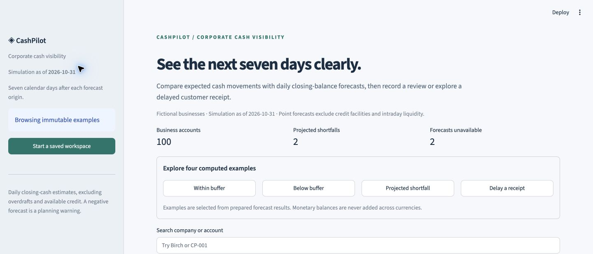
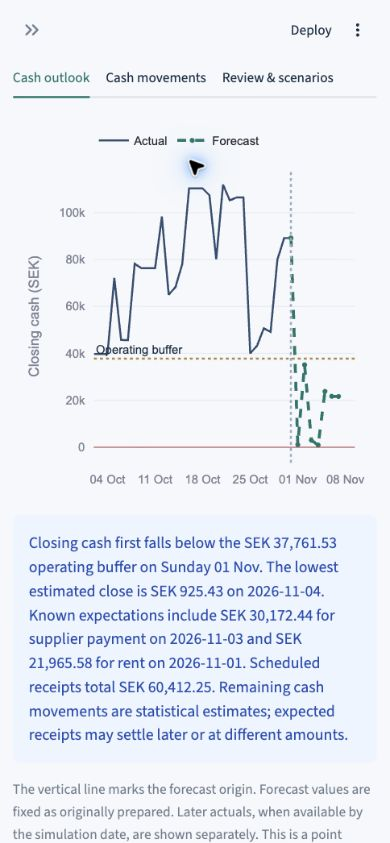
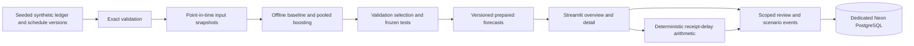

# CashPilot — Corporate Cash-Flow Forecasting

Seven-day cash visibility for a corporate banking relationship manager: identify a possible shortfall, understand the expected payments behind it, and save a review or receipt-delay plan.

**Built by Enamul Haque · version 1.0.0 · fictional businesses · simulation as of 31 October 2026.**



## Try the workflow

Open one of four computed examples, inspect the seven-day outlook and underlying movements, then open **Review & scenarios**. Start a saved workspace to record a note and review status. Delay a customer receipt by 1–14 calendar days, compare the original and adjusted paths, and save a named scenario. Bookmark the private workspace URL to recover history after refresh or restart.

The demonstration includes 100 businesses in Finland/EUR, Sweden/SEK and Switzerland/CHF; 104,900 daily balance rows and 180,824 booked transactions. Five archived origins per account retain their original forecasts. Later actual outcomes appear separately. Two latest snapshots intentionally demonstrate invalid-input handling.



## Forecast design and measured results

Expected payments and receipts remain separate from estimated remaining flows. Closing cash equals observed cash plus cumulative scheduled and estimated inflows minus outflows. Integer minor-unit arithmetic reconciles the ledger exactly. Only records visible at each end-of-day origin become inputs. Prepared forecasts ship with the app; opening a page never trains a model.

Validation selected **pooled gradient boosting** (scikit-learn histogram boosting, separate nonnegative inflow/outflow regressors) over a seasonal-naive baseline. Selection was frozen before two chronological tests.

| Seven-day shortfall test | Baseline precision / recall | Gradient boosting precision / recall | Candidate missed / false alarms |
|---|---:|---:|---:|
| Known businesses: 1,040 account-origins, 138 events | 83.0% / 56.5% | 88.7% / 62.3% | 52 / 11 |
| Unseen businesses: 260 account-origins, 36 events | 100.0% / 61.1% | 91.7% / 61.1% | 14 / 2 |

The candidate reduces normalized balance error in both tests, but does not improve unseen-business shortfall recall. These are synthetic simulator results, not evidence of banking performance or financial impact. See [evaluation](docs/EVALUATION.md) for chronological cutoffs, denominators, native-currency errors, buffer warnings and failure examples; [machine-readable metrics](evaluation/results/metrics.json) include every currency, horizon and sector.

## Architecture



See [architecture and data contract](docs/ARCHITECTURE.md).

## Run locally

Python 3.12 is recommended.

```sh
python3.12 -m venv .venv
source .venv/bin/activate
pip install -r requirements.txt
streamlit run app.py
```

With no database configured, browsing and scenario preview work read-only. For explicitly local persistence, set `CASHPILOT_MODE=local` and optionally `CASHPILOT_SQLITE_PATH=cashpilot.sqlite`. This local mode initializes its own SQLite database. Hosted mode requires PostgreSQL and never falls back to a local file.

For Neon, copy `.env.example` to `.env`, supply pooled application and direct migration URLs privately, then run `cashpilot migrate --env .env`. See [hosting](docs/HOSTING.md) for Streamlit secrets and the tested branch-first migration procedure. Never put credentials in Git.

```sh
pytest -q
ruff check .
python -m compileall -q src app.py
cashpilot pipeline --smoke --output /tmp/cashpilot-smoke
# Reproduce the full dataset, fit, evaluation and prepared app artifacts:
cashpilot pipeline --output .
```

The full recorded run took about 308 seconds on the development machine. Smoke evaluation is deliberately smaller and does not replace the committed full evaluation. Full regeneration replaces bundled artifacts; run it in a separate output directory when comparing versions. Load only trusted local model artifacts.

Docker: `docker build -t cashpilot .` then `docker run --rm -p 8501:8501 --env-file .env cashpilot`. Runtime needs only the prepared bundle, not raw simulator data or model training.

## Persistence and interpretation

Reviews append timestamped events and belong to a specific forecast origin. A different origin begins Not reviewed; review status never suppresses an alert. Scenario saves reference the original forecast and schedule version and leave original predictions untouched. A receipt delayed outside the horizon stays outside it; remaining-flow estimates are held fixed.

Workspace URLs are opaque bearer capabilities, not authenticated analyst accounts. Anyone holding a return URL can access that workspace. Use fictional notes only; do not share the URL. A new browser without that key starts separately. Reset affects only that workspace and fences late writes. This public demonstration is not a production banking access-control system.

Cash means daily closing cash excluding credit facilities. No intraday liquidity, borrowing eligibility or guaranteed settlement is modelled. Forecasts are point estimates without confidence bands. Negative balances are planning warnings. Currency amounts are never summed across currencies.

[Verification evidence](docs/VERIFICATION.md) · [Sources and licences](docs/SOURCES.md) · [MIT licence](LICENSE)

Implementation was developed with AI coding assistance; the repository includes executable checks and measured evaluation rather than claims of real customer outcomes.
